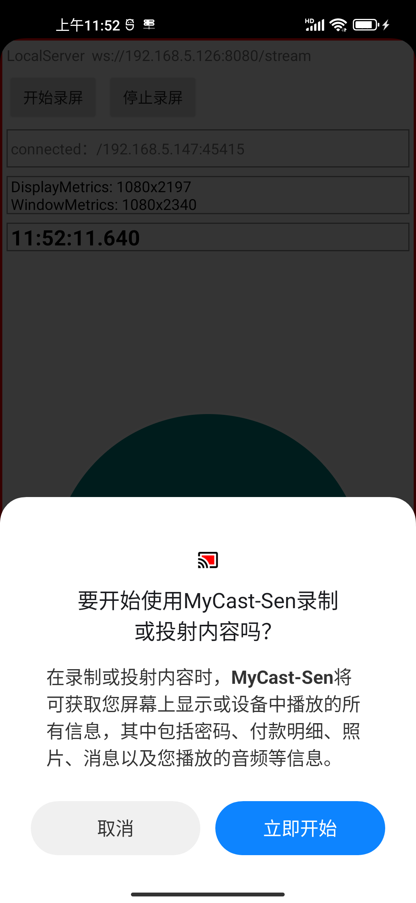

##  English Version: `README.en.md`

```markdown
# MyCast

> LAN-based Android-to-Android screen casting with MediaProjection + MediaCodec + WebSocket

[](https://developer.android.com)
[](LICENSE)

[中文文档](README.md) | **English**

##  Features

- **Auto Discovery**: mDNS / UDP broadcast based, zero configuration within LAN
- **Real-time Casting**: MediaProjection capture + MediaCodec hardware H.264 encoding, low end-to-end latency
- **Zero Dependencies**: Pure system APIs, no root required, no extra plugins
- **Dual-role Codebase**: Same codebase, roles distinguished by `sender` / `receiver` modules
- **Network Friendly**: Dynamic bitrate adaptation and keyframe request support

##  Demo

| Device Discovery | Casting |
| :---: | :---: |
|  |  |

##  Getting Started

### Requirements

- Android Studio Hedgehog or later
- JDK 17
- Android SDK 24+ (minSdk 24, targetSdk 34)

### Build & Run

```bash
git clone https://github.com/devin1014/MyCast.git
cd MyCast
./gradlew assembleDebug
```

Install both APKs onto two devices on the same LAN:

```bash
adb install sender/build/outputs/apk/debug/sender-debug.apk
adb install receiver/build/outputs/apk/debug/receiver-debug.apk
```

> **Note**: Casting requires user authorization. A system screen-recording permission dialog will appear on first launch — tap "Start Now".

### Usage

1. Connect both devices to the **same WiFi**
2. Launch the App on the receiver — it enters "Waiting for connection" state
3. Launch the App on the sender — it automatically discovers the receiver
4. Tap the device name, grant recording permission, and casting begins

## ️ Architecture

```
┌─────────────┐         WebSocket (TCP)         ┌──────────────┐
│   Sender    │  ──────────────────────────────  │   Receiver   │
│             │                                   │              │
│ MediaProjection                             MediaCodec
│   ↓ Capture                                     ↓ Decode
│ MediaCodec (H.264 encode)                   SurfaceView render
│   ↓ Frame split
│ WebSocket send
└─────────────┘                                   └──────────────┘
        ↑                                               ↑
        └──────────── Discovery (mDNS/UDP) ─────────────┘
```

### Core Modules

| Module | Description |
| :--- | :--- |
| `:sender` | Capture side — screen capture, encoding, streaming |
| `:receiver` | Receive side — decoding, rendering, audio playback |
| `:common` | Shared protocol definitions, device discovery, utilities |

### Key Implementation Details

**1. Screen Capture**

`MediaProjection` + `VirtualDisplay` render screen content directly to a `Surface`, avoiding CPU copies.

```kotlin
val projection = manager.createProjection(virtualDisplay.surface, width, height, dpi)
virtualDisplay = VirtualDisplay.create(
    "MyCastDisplay", width, height, dpi,
    DisplayManager.VIRTUAL_DISPLAY_FLAG_PUBLIC,
    projection.surface, null, null
)
```

**2. Hardware Encoding**

`MediaCodec` consumes the `Surface` directly with zero copy; quality and latency are balanced via `KEY_BIT_RATE` and `KEY_FRAME_RATE`.

```kotlin
val format = MediaFormat.createVideoFormat(MimeTypes.VIDEO_H264, width, height).apply {
    setInteger(MediaFormat.KEY_BIT_RATE, 4_000_000)
    setInteger(MediaFormat.KEY_FRAME_RATE, 30)
    setInteger(MediaFormat.KEY_I_FRAME_INTERVAL, 1)
    setInteger(MediaFormat.KEY_COLOR_FORMAT,
        MediaCodecInfo.CodecCapabilities.COLOR_FormatSurface)
}
```

**3. Device Discovery**

Prefers `NsdManager` (mDNS), falling back to UDP broadcast — compatible with enterprise networks that block multicast.

**4. Transport Protocol**

Custom binary frame header carrying timestamp, keyframe flag and sequence number, enabling frame dropping and reordering on the receiver:

```
| magic(2B) | version(1B) | flags(1B) | seq(4B) | pts(8B) | payloadLen(4B) | payload |
```

## ️ Configuration

Adjust in `CastConfig` of the `sender` module:

| Parameter | Default | Description |
| :--- | :--- | :--- |
| `bitrate` | 4 Mbps | Encoding bitrate; lower to 2 Mbps on weak networks |
| `frameRate` | 30 | Frame rate |
| `iframeInterval` | 1s | Keyframe interval; smaller improves packet-loss resilience but raises bitrate |
| `detectWidth/Height` | 640×480 | Downsampled resolution for auxiliary detection |

##  FAQ

### Crash with `IllegalStateException` right after casting starts

Usually a `MediaCodec` lifecycle issue: the callback fires after the codec has been `stop()`ed/`release()`d.

**Fix**: add a state guard and try-catch in the callback, and set `isRunning = false` **before** calling `stop()`:

```kotlin
@Volatile private var isRunning = false

override fun onOutputBufferAvailable(codec: MediaCodec, index: Int, info: MediaCodec.BufferInfo) {
    if (!isRunning) {
        codec.releaseOutputBuffer(index, false)
        return
    }
    try {
        val buffer = codec.getOutputBuffer(index)
        // ... process data
        codec.releaseOutputBuffer(index, true)
    } catch (e: IllegalStateException) {
        Log.w("Decoder", "codec not ready", e)
    }
}
```

### Some devices cannot be discovered

- Check whether both devices are on the same subnet (different VLANs cannot be discovered)
- Some routers enable "AP isolation", which blocks multicast — disable it
- You can also enter the peer IP manually to connect directly

### Casting stops after screen off

Android 10+ restricts background `MediaProjection`. Keep the Activity in the foreground, or use a foreground service to stay alive.

##  License

MIT License. See LICENSE for details.

##  Acknowledgements

- [Java-WebSocket](https://github.com/TooTallNate/Java-WebSocket) — WebSocket implementation reference
```

---