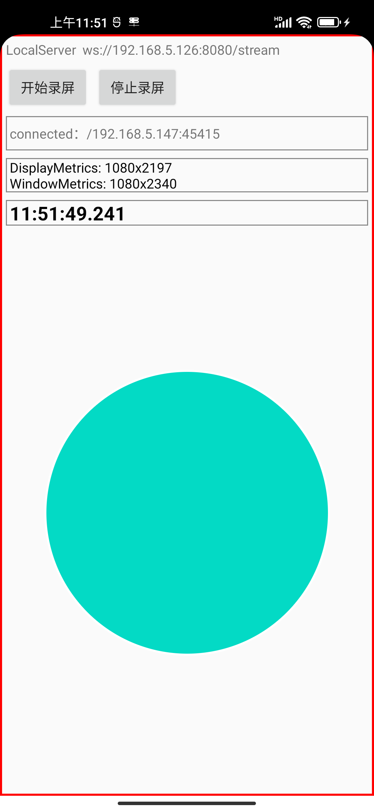
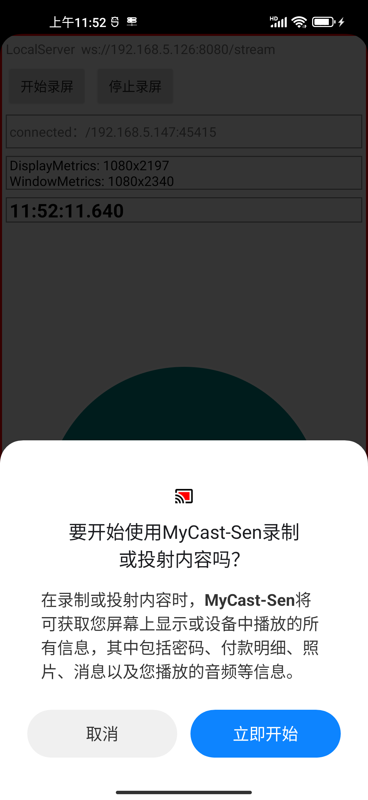
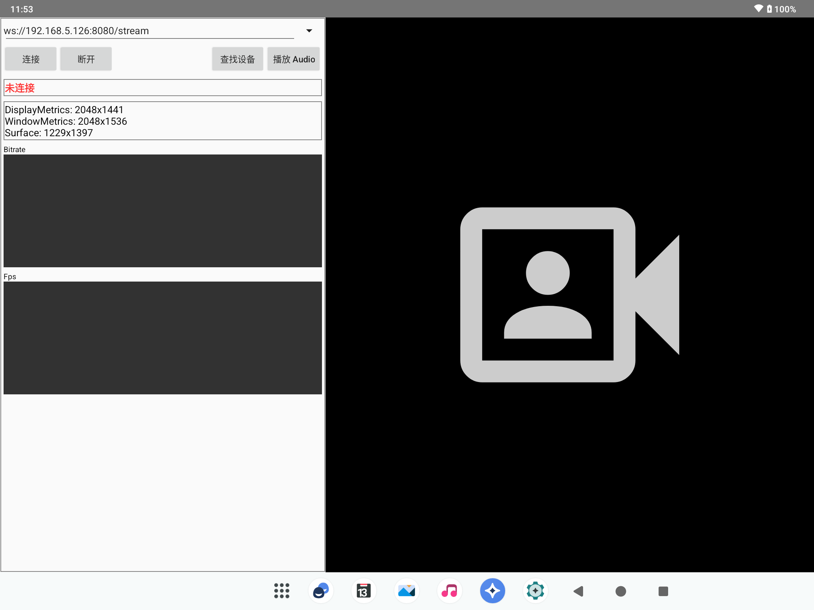
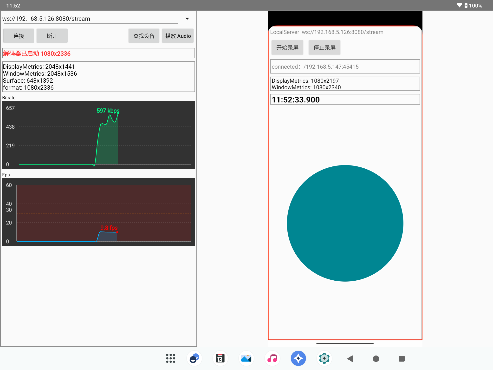

# MyCast

> 基于 MediaProjection + MediaCodec + WebSocket 的局域网安卓设备间投屏方案

[简体中文](README.md) | [English](README.en.md)

[](https://developer.android.com)
[](LICENSE)

##  特性

- **自动发现**：基于 mDNS / UDP 广播，局域网内设备免配置互相发现
- **实时投屏**：MediaProjection 采集屏幕，MediaCodec 硬编码 H.264，端到端延迟低
- **零依赖**：纯系统 API 实现，无需 root、无需安装额外插件
- **双端复用**：同一套代码通过 `sender` / `receiver` 两个模块区分角色
- **弱网友好**：支持动态码率调整与关键帧请求

##  效果演示

|                   投屏端                   |                   投屏端                   |
|:------------------------------------------:|:------------------------------------------:|
|  |  |


|                   接收端                   |                   接收端                   |
|:------------------------------------------:|:------------------------------------------:|
|  |  |


##  快速开始

### 环境要求

- Android Studio Hedgehog 或更高版本
- JDK 17
- Android SDK 24+（minSdk 24，targetSdk 34）

### 编译运行

```bash
git clone https://github.com/devin1014/MyCast.git
cd MyCast
./gradlew assembleDebug
```

安装两个 APK 到同一局域网内的两台设备：

```bash
adb install sender/build/outputs/apk/debug/sender-debug.apk
adb install receiver/build/outputs/apk/debug/receiver-debug.apk
```

> **注意**：投屏需要用户授权，首次启动会弹出系统录屏权限对话框，请点击「立即开始」。

### 使用流程

1. 两台设备连接**同一个 WiFi**
2. 接收端启动 App，进入「等待连接」状态
3. 发送端启动 App，自动扫描到接收端设备
4. 点击设备名称，授权录屏权限，投屏开始

## ️ 架构设计

```
┌─────────────┐         WebSocket (TCP)         ┌──────────────┐
│   Sender    │  ──────────────────────────────  │   Receiver   │
│             │                                   │              │
│ MediaProjection                             MediaCodec
│   ↓ 采集                                        ↓ 解码
│ MediaCodec (H.264 编码)                     SurfaceView 渲染
│   ↓ 分帧
│ WebSocket 发送
└─────────────┘                                   └──────────────┘
        ↑                                               ↑
        └────────────── 设备发现 (mDNS/UDP) ────────────┘
```

### 核心模块

| 模块 | 说明 |
| :--- | :--- |
| `:sender` | 采集端，负责屏幕捕获、编码、推流 |
| `:receiver` | 接收端，负责解码、渲染、音频播放 |
| `:common` | 公共协议定义、设备发现、工具类 |

### 关键技术点

**1. 屏幕采集**

使用 `MediaProjection` + `VirtualDisplay`，将屏幕内容渲染到 `Surface`，避免 CPU 拷贝。

```kotlin
val projection = manager.createProjection(virtualDisplay.surface, width, height, dpi)
virtualDisplay = VirtualDisplay.create(
    "MyCastDisplay", width, height, dpi,
    DisplayManager.VIRTUAL_DISPLAY_FLAG_PUBLIC,
    projection.surface, null, null
)
```

**2. 硬件编码**

`MediaCodec` 直接消费 `Surface`，零拷贝；通过 `KEY_BIT_RATE` 和 `KEY_FRAME_RATE` 控制画质与延迟的平衡。

```kotlin
val format = MediaFormat.createVideoFormat(MimeTypes.VIDEO_H264, width, height).apply {
    setInteger(MediaFormat.KEY_BIT_RATE, 4_000_000)
    setInteger(MediaFormat.KEY_FRAME_RATE, 30)
    setInteger(MediaFormat.KEY_I_FRAME_INTERVAL, 1)
    setInteger(MediaFormat.KEY_COLOR_FORMAT,
        MediaCodecInfo.CodecCapabilities.COLOR_FormatSurface)
}
```

**3. 设备发现**

优先使用 `NsdManager`（mDNS），失败时降级为 UDP 广播，兼容部分企业网络的组播限制。

**4. 传输协议**

自定义二进制帧头，包含时间戳、关键帧标记、序列号，便于接收端做丢帧和重排：

```
| magic(2B) | version(1B) | flags(1B) | seq(4B) | pts(8B) | payloadLen(4B) | payload |
```

## ️ 配置项

在 `sender` 模块的 `CastConfig` 中可调整：

| 参数 | 默认值 | 说明 |
| :--- | :--- | :--- |
| `bitrate` | 4 Mbps | 编码码率，网络差时建议降到 2 Mbps |
| `frameRate` | 30 | 帧率 |
| `iframeInterval` | 1s | 关键帧间隔，越小抗丢包越好但码率上升 |
| `detectWidth/Height` | 640×480 | 辅助识别的降采样分辨率 |

##  常见问题

### 投屏启动后立刻崩溃，报 `IllegalStateException`

通常是 `MediaCodec` 生命周期问题：回调触发时解码器已被 `stop()`/`release()`。

**解决**：在回调中加状态守卫与 try-catch，且 `isRunning = false` 必须在 `stop()` 之前设置：

```kotlin
@Volatile private var isRunning = false

override fun onOutputBufferAvailable(codec: MediaCodec, index: Int, info: MediaCodec.BufferInfo) {
    if (!isRunning) {
        codec.releaseOutputBuffer(index, false)
        return
    }
    try {
        val buffer = codec.getOutputBuffer(index)
        // ... 处理数据
        codec.releaseOutputBuffer(index, true)
    } catch (e: IllegalStateException) {
        Log.w("Decoder", "codec not ready", e)
    }
}
```

### 部分设备无法发现

- 检查两台设备是否在同一网段（不同 VLAN 无法发现）
- 部分路由器开启了「AP 隔离」，会阻断组播，需关闭
- 可手动输入对方 IP 直连

### 息屏后投屏中断

Android 10+ 对后台 `MediaProjection` 有限制，需保持 Activity 在前台，或配合前台服务保活。

##  License

MIT License. See LICENSE for details.

##  致谢

- [Java-WebSocket](https://github.com/TooTallNate/Java-WebSocket) — WebSocket 实现参考
